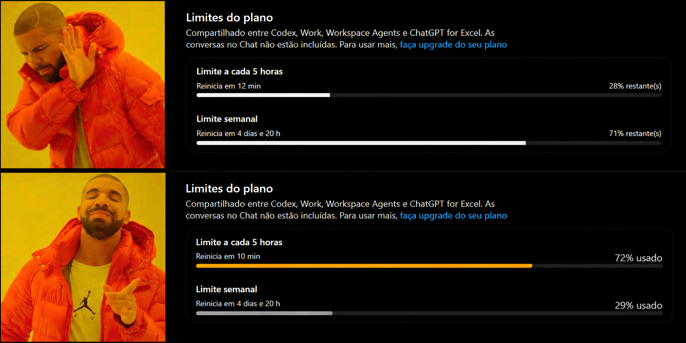
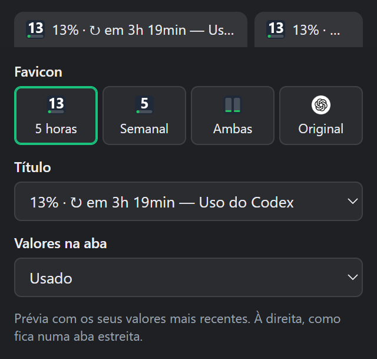

# Codex Usage Fix

Extensão Chrome (MV3) que troca "X% restante(s)" por "Y% usado" nos limites de 5 horas e semanal em
`chatgpt.com/settings/usage`.

## Por quê?
Claude, Cursor e a maioria das ferramentas mostram a **cota utilizada**: a barra enche conforme você
gasta. A tela de uso do Codex faz o contrário e mostra a **cota restante**, o que obriga a inverter o
raciocínio a cada vez que se olha. Essa extensão padroniza a exibição: **28% restante** passa a ser
**72% usado**.

## Instalação
1. Abra `chrome://extensions` e ative o **Modo do desenvolvedor**.
2. **Carregar sem compactação** e selecione esta pasta.
3. Abra https://chatgpt.com/settings/usage e atualize a página.

## Como funciona
- Não altera o texto original (o React o reverteria). Os elementos originais ficam com `opacity:0` e
  uma camada em Shadow DOM, fixa no `<body>`, é desenhada exatamente por cima.
- Lê o valor do `<progress>` original a cada frame: atualização em tempo real.
- A barra passa a encher conforme o uso; fica âmbar a partir de 70% e vermelha a partir de 90%.
- A aba também mostra o uso da janela de 5 horas: título `13% · ↻ em 3h 19min — Uso do Codex`
  (números primeiro, para continuarem visíveis com muitas abas abertas) e favicon com o número e
  uma barra. Ao sair da página, título e favicon originais voltam.
- Clicando no ícone da extensão:
  - **Favicon**: 5 horas, semanal, 5 horas e semanal (duas barras) ou o original do ChatGPT.
  - **Título**: sugestões que combinam com o favicon escolhido, ou um personalizado com
    `{5h}`, `{sem}`, `{reset5h}`, `{resetsem}` (quanto falta para reiniciar), `{codex}` e `{pagina}`.
  - **Valores na aba**: usado (padrão) ou restante.

  A mudança vale na hora, sem recarregar a aba.

  

- Para voltar ao comportamento original, desative a extensão.

## Observação
O número grande em "Uso recente do plano" não é alterado.
